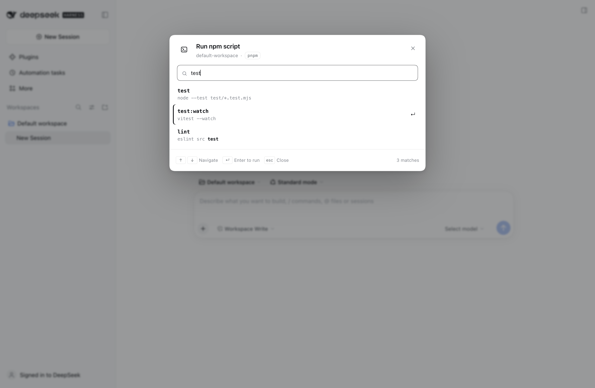
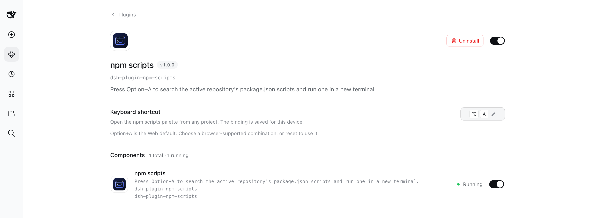

# npm scripts for DeepSeek Harness

Press **Option+A** in any DeepSeek Harness session to open a searchable list of the active repository's `package.json` scripts. Pick one with the keyboard, and it starts in a new Harness terminal tab; choosing the same script again offers to restart it in that tab. The shortcut is configurable from the plugin's own page.

<p align="center">
  <picture>
    <source media="(prefers-color-scheme: dark)" srcset="docs/npm-scripts-dark.png" />
    
  </picture>
</p>

## Features

- **Option+A from anywhere** in the session — composer, page, or terminal.
- **Configurable shortcut** in the plugin's own **Plugins** page, using the same device-local bindings as **Settings → Keyboard shortcuts**.
- **Search filter** over script names and commands, case-insensitive and ranked so exact and prefix matches come first.
- **Keyboard first**: `↑` / `↓` navigate, `Home` / `End` jump, `PageUp` / `PageDown` move a page, `Enter` runs, `Esc` closes. The search field uses the ARIA combobox + listbox pattern, so screen readers announce the active script.
- **Runs in a real Harness terminal**: opens a new terminal tab in the right sidebar, waits for the shell to attach, then types the selected command.
- **Restarts instead of duplicating**: choosing a script that already has a terminal tab asks first; accepting sends Ctrl+C to stop anything running there and runs the script again in that same tab.
- **Correct package manager**: reads `packageManager` and lockfiles, supporting `npm`, `pnpm`, `yarn`, and `bun`.
- **Monorepo aware**: walks up from the session folder to the Git root and uses the nearest `package.json`, then `cd`s into that package before running.
- **Safe quoting**: script names are quoted for the target shell instead of being pasted as raw shell syntax.
- **English and Chinese** UI.
- **No project code runs in the Host**: discovery only reads `package.json`; the terminal runs the script with the user's normal terminal permissions.

## Install

In the desktop app, open **Plugins** in the sidebar, choose **Add plugin**, and enter the local directory path. The desktop profile is managed by the Electron app, which is why this is the preferred path there.

For another profile, use the CLI:

```bash
git clone https://github.com/jeremytenjo/dsh-plugin-npm-scripts.git
dsh plugin --profile <profile> add ./dsh-plugin-npm-scripts
```

Replace `<profile>` with the name shown by `dsh --profile <name> --dump-config` (for example `web`). Restart the Host or reload the page after installing.

The package ships its browser bundle (`client.js`), so no build step is required to install it.

## Usage

The plugin is profile-wide: install it once and it is enabled by default in every session. It adds nothing to individual projects and there is no per-project switch — a project only needs a `package.json`.

1. Open a session whose working directory is inside a repository with a `package.json`.
2. Press **Option+A** (`⌥A`).
3. Type to filter the scripts.
4. Use `↑` / `↓` to highlight a script and press `Enter`. The first result is selected automatically, so `Option+A`, `Enter` runs the first script.
5. A new terminal tab opens, is renamed to the script name, and receives the command.
6. Choose the same script again while its tab is still open. The palette asks **Restart script?**; **Restart script** sends Ctrl+C to the running process, waits for the shell, and types the command again in that same tab. **Cancel** keeps the process running.
7. To use a different key, open **Plugins → npm scripts → Keyboard shortcut** and record a new binding (see [Configuration](#configuration)).

The command shown in the palette is what will be typed:

```bash
cd '/path/to/package' && pnpm run 'build'
```

`cd` is omitted when the package already is the session working directory.

### Which scripts appear

The palette uses the nearest `package.json` between the session working directory and the repository root. This means a session opened in a monorepo package shows that package's scripts, while a session at the repository root shows the root scripts.

If no `package.json` exists, the palette shows an error with a retry action.

### Package manager detection

1. `packageManager` in `package.json` (`pnpm@9.15.0`, `yarn@4.5.0`, …).
2. A lockfile in the package directory, then the repository root:
   - `pnpm-lock.yaml`
   - `yarn.lock`
   - `bun.lockb` / `bun.lock`
   - `package-lock.json` / `npm-shrinkwrap.json`
3. `npm`.

## Configuration

| Setting | Where | Default |
| --- | --- | --- |
| Keyboard shortcut | **Plugins → npm scripts → Keyboard shortcut** | `Option+A` on macOS, `Alt+A` on Windows/Linux |

Open **Plugins** in the sidebar and select **npm scripts**. Select the current binding (the keycaps with the pencil), press the new combination, and release to save.

- **Esc** cancels recording.
- **Reset to default** restores the default binding after a custom one has been saved.
- Combinations already used by Harness or the operating system are rejected with a conflict/reserved message.
- The binding is saved per device, in the same store as **Settings → Keyboard shortcuts**; it is not written into the repository. Editing the shortcut in either place updates the same preference.

<p align="center">
  <picture>
    <source media="(prefers-color-scheme: dark)" srcset="docs/npm-scripts-settings-dark.png" />
    
  </picture>
</p>

On the Desktop app the binding is registered with the native keyboard service. On the Web, Option+A is a local fallback because browsers reject single-modifier Option bindings; saving a browser-supported combination replaces that fallback, and **Reset to default** brings Option+A back.

## Keyboard model

| Key | Action |
| --- | --- |
| `Option+A` (default) | Open the palette; press again to close. Change it on the plugin page. |
| `↑` / `↓` | Move the highlight |
| `Home` / `End` | First / last script |
| `PageUp` / `PageDown` | Move six rows |
| `Enter` | Run the highlighted script; in the restart prompt, restart it |
| `Esc` | Close the palette; in the restart prompt, cancel it |
| `Tab` / `Shift+Tab` | Cycle focus between search and close |

While the palette is open, Harness's modal layer blocks background shortcuts. The effective binding appears in both **Settings → Keyboard shortcuts** and the plugin page; editing either place updates the same preference. In the Web app, Option+A remains a local fallback until you save a browser-supported combination.

## How it works

- The browser half registers a `plugins.bundle.config` page for `dsh-plugin-npm-scripts`. It records one physical key combination, validates it with the shortcut service (`describeBinding`), and persists it through `ctx.shortcuts.edit`.
- The Host half registers one exact loopback route, `POST /__dsh/npm-scripts`.
- The browser sends the active Session id. The Host resolves that Session's working directory itself, runs `git rev-parse --show-toplevel`, walks to the nearest `package.json`, parses it, and returns the scripts plus the detected package manager.
- The browser half builds a quoted command and asks the right sidebar to open a `terminal` tab.
- It subscribes to the terminal view until it becomes writable, renames the tab to the script name, waits for the first prompt, and writes the command.
- Each launch is remembered per Session, package, and script in this device's `localStorage`, together with the Host terminal identity. Choosing that script again resolves the saved tab before anything runs.
- If the saved shell is still running, the palette asks before restarting. Accepting expands and focuses the tab, writes Ctrl+C, waits for the output to settle, and types the command again in the same tab. A closed or exited tab starts a new terminal tab instead.

The Host route never runs project scripts, never accepts a client filesystem path, and refuses non-loopback or cross-origin requests.

## Development

```bash
pnpm install
pnpm test      # filter, quoting, and manifest tests
pnpm build     # regenerates client.js
```

`src/client.jsx` is the browser source. `src/filter.js` and `src/shell.js` are pure, testable helpers. `client.js` is generated by esbuild and wrapped for the Harness module loader; commit the regenerated bundle with source changes.

Layout while developing:

```text
index.js              Host route and repository inspection
src/client.jsx        Modal, shortcut, terminal launch and restart
src/filter.js         Search/ranking and highlight slices
src/launches.js       Script-to-terminal records for the restart prompt
src/shell.js          Package-manager command construction and quoting
test/*.test.mjs       Node test runner suites
cordis.patch.yml      Profile layer entry
```

## Requirements

- DeepSeek Harness `0.2.1-rc.3` or newer.
- A session inside a project with a `package.json`.
- The built-in right-sidebar terminal (enabled in the shipped Web and Desktop bundles).
- Git is optional; without it the palette falls back to the session working directory.

## Security and limits

- Script names and package paths are shell-quoted for the target platform; NUL bytes are rejected.
- Only scripts from the selected `package.json` are listed, at most 1000, with bounded name and command lengths.
- Scripts run in the user's terminal with the user's normal permissions, independent of the Agent sandbox, exactly like a terminal command typed by hand.
- Restarting uses the same terminal input path as typing: it sends Ctrl+C to the foreground process group and then the command, so it never force-kills unrelated processes.
- The palette follows the nearest `package.json`; it does not scan every workspace package or browse `node_modules`.
- Terminal recovery and process lifetime follow Harness's terminal controller. Closing the tab ends the process tree according to the terminal provider.

## License

MIT
